# Cycleur — Milestone 3

Scenic cycling routes: every H3 cell (~130 m) gets 15 scenery scores (tree canopy, water access, historic character, …) predicted from a single aerial image.

## Progress since Milestone 2

### New dataset

### Model training

The final model was picked by changing one thing at a time: an aerial tile (256×256) → 15 scores (0–1).

| | Final choice |
|---|---|
| Backbone | DINOv2-S (`vit_small_patch14_dinov2.lvd142m`) |
| Fine-tuning | Last 2 transformer blocks + final norm unfrozen, the rest frozen (3.56M of 21.6M parameters) |
| Head | Linear + sigmoid |
| Fixed recipe (not grid-searched) | batch 16, ≤25 epochs, early stop after 5 epochs without val-MAE gain, head LR 3e-4, encoder LR 1e-5, weight decay 1e-4, grad clip 1.0, SmoothL1 (β 0.1), random flips + 90° turns, fp16, seed 42 |

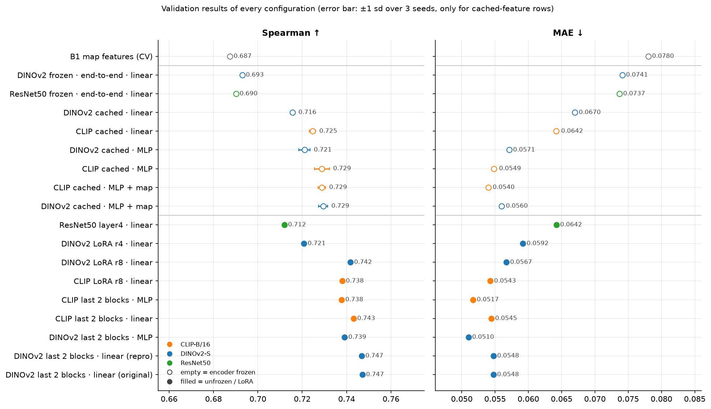

Hollow = encoder frozen, filled = unfrozen or LoRA. Experiments used the `full_v1` targets, the final run `full_v2`, so their numbers are not directly comparable. In total: 11 end-to-end runs plus 48 + 57 cached-feature trainings (3 seeds). Cached-feature differences count only above 2× the seed standard deviation; end-to-end runs have one seed, so differences below about 0.01 Spearman are indications, not conclusions. Metrics: MAE on the 0–1 scale (lower is better), tolerance accuracy (share within ±0.05 / ±0.10 / ±0.20), Spearman (ranking).

**C0 · Starting line.** Predicting the training mean: MAE 0.1753 (5-fold CV) / 0.1844 (test). Map features only (LightGBM): Spearman 0.688 / 0.669, MAE 0.0780 / 0.0942 (CV / test). Image models must clearly beat this.

**C1 · Frozen backbone.** Cached features: CLIP-B/16 0.725 > DINOv2-S 0.716 > ResNet50 0.673 (Spearman; MAE 0.0642 / 0.0670 / 0.0755). The same backbone is worse end-to-end (DINOv2 0.693) because the recipe differs, so only compare runs from the same code and settings.

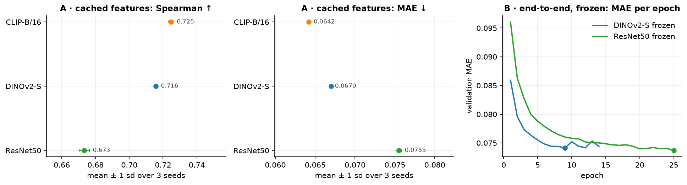

**C2 · Head, backbone frozen.** A bigger head (MLP) lowers the error size by about 15% (CLIP 0.0642 → 0.0549, DINOv2 0.0670 → 0.0571, ResNet50 0.0755 → 0.0639) but barely changes the ranking (Spearman +0.004 to +0.031). Ridge has the worst MAE (outputs not bounded to 0–1).

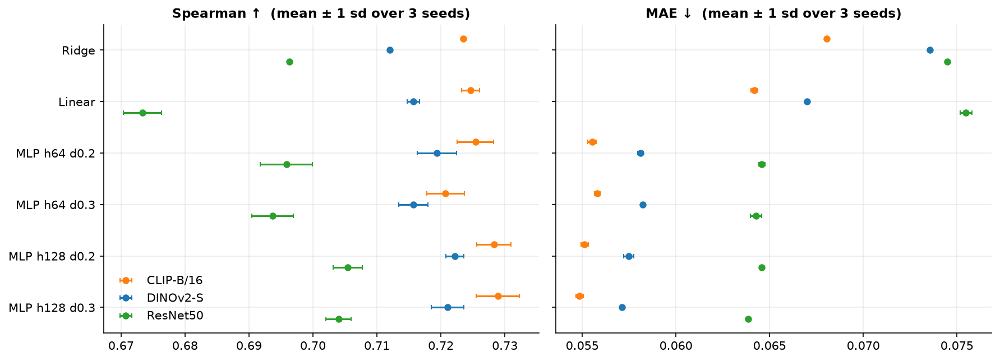

**C3 · Map features, ranking loss, Spearman stopping.** Map features: MAE −1.5% (CLIP), −2.1% (DINOv2), −2.6% (ResNet50), Spearman only +0.008 on DINOv2. Ranking loss (0.05 / 0.2): Spearman unchanged, MAE up to 6% worse. Stopping on Spearman: no gain, MAE worse. Map features were not tested with an unfrozen backbone, so the final model does not use them.

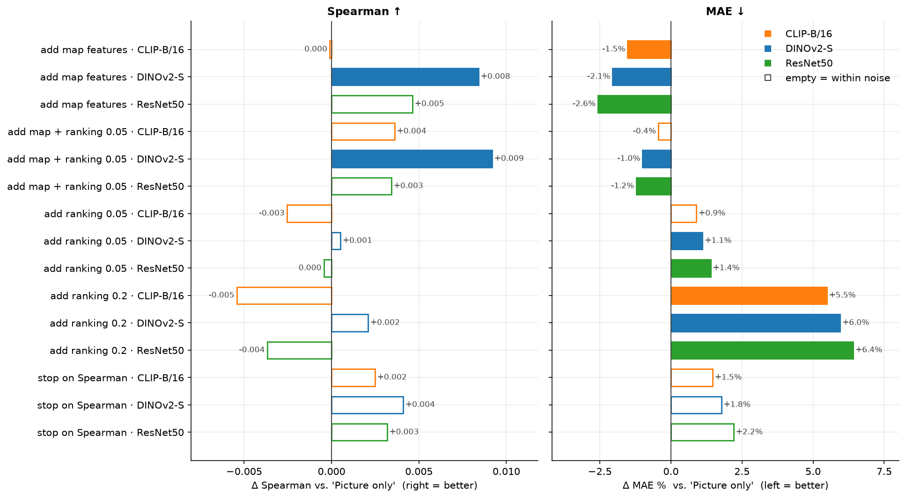

**C4 · Frozen vs. unfrozen.** DINOv2-S, last 2 blocks unfrozen: Spearman 0.693 → **0.747**, MAE 0.0741 → **0.0548** (−26%). ResNet50 (`layer4`): 0.690 → 0.712, MAE −12.9%. Unfreezing helps in every comparison (Spearman +0.018 to +0.054, MAE −4% to −26%) and costs about 1 h on a T4 versus seconds for a cached head.

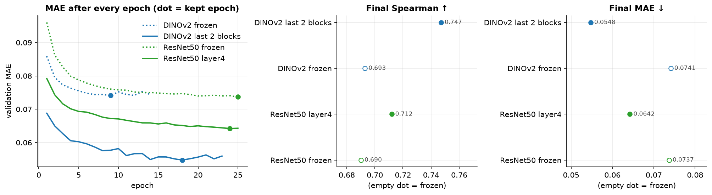

**C5 · Direct unfreezing vs. LoRA.** Nothing shows LoRA beating direct unfreezing, which is simpler (LoRA's advantage: tiny adapter files, 0.3–1.2 MB).

| Backbone | Method | Spearman | MAE | Minutes |
|---|---|---|---|---|
| DINOv2-S | **last 2 blocks** | **0.747** | **0.0548** | 55 |
| DINOv2-S | LoRA r8 | 0.742 | 0.0567 | 54 |
| DINOv2-S | LoRA r4 | 0.721 | 0.0592 | 32 (early stop) |
| CLIP | last 2 blocks | 0.743 | 0.0545 | 46 |
| CLIP | LoRA r8 | 0.738 | 0.0543 | 81 |

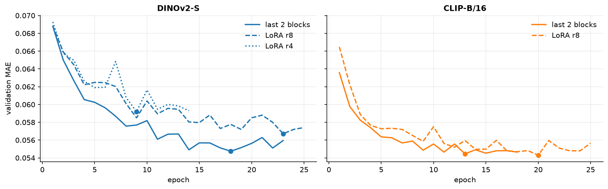

**C6 · After unfreezing: head and backbone.** The MLP still lowers MAE (DINOv2 −6.9%, CLIP −5.0%) but Spearman is flat, and CLIP's frozen advantage disappears (gap ≤ 0.005).

| Model | Spearman | MAE | ±0.05 | ±0.10 | ±0.20 |
|---|---|---|---|---|---|
| DINOv2 · linear | **0.747** | 0.0548 | 65.4% | 81.1% | 94.7% |
| DINOv2 · MLP | 0.739 | **0.0510** | **67.5%** | 81.7% | 94.6% |
| CLIP · linear | 0.743 | 0.0545 | 65.4% | 81.3% | 94.8% |
| CLIP · MLP | 0.738 | 0.0517 | **67.8%** | 81.4% | 94.2% |

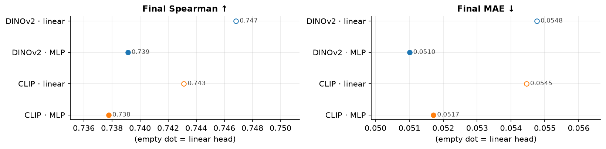

How we reached the final configuration:

| Decision | Choice | Why | Confidence |
|---|---|---|---|
| Unfreeze the backbone? | Yes | C4: better in every comparison | High |
| Backbone | DINOv2-S | C6: ties CLIP after unfreezing; faster (124 vs 356 ms/image on CPU, 1.1 vs 2.2 ms/image on a T4) | Medium (1 seed) |
| How to unfreeze | Last 2 blocks + norm | C5: not worse than LoRA, simpler | Medium (1 seed) |
| Head | Linear | C6: higher Spearman, simplest; but the MLP has 6.9% lower MAE and about 2 points higher ±0.05 accuracy | Low: needs a second seed |
| Map features | Not used | C3: small frozen gain, never tested unfrozen; needs map data at prediction time | Unverified |
| Ranking loss, Spearman stopping | Not used | C3: no gain, MAE worse | Medium |

**Final run** (`gs://<bucket>/results/full_v2/final/dinov2_s-linear-seed42-<id>/`, T4, about 61 min):

| Metric | Predict training mean | Validation | **Test (4 unseen places)** |
|---|---|---|---|
| MAE | 0.1849 | 0.0550 | **0.0699** |
| within ±0.05 / ±0.10 / ±0.20 | 19% / 34% / 68% | 66% / 80% / 94% | **58% / 74% / 92%** |
| Spearman | – | 0.761 | **0.753** |

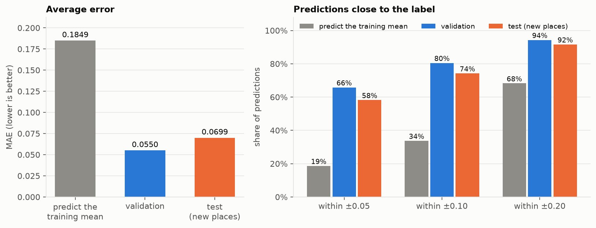

Report the test numbers for new places; validation shares areas with training and is optimistic. The test set was evaluated once.

Limitations: one seed per end-to-end run; labels are Gemini scores, so a low error means agreement with Gemini; `farmland_pastoral`, `industrial_area` and `water_access` stay weak in every configuration. Experiment runs are in `gs://<bucket>/results/full_v1/`.

### Automatic training pipeline

### Routing algorithm

Describe the ride you want, tap a start and an end, and get the **shortest route plus three options** that trade a little extra
distance for a route that fits the ride better.

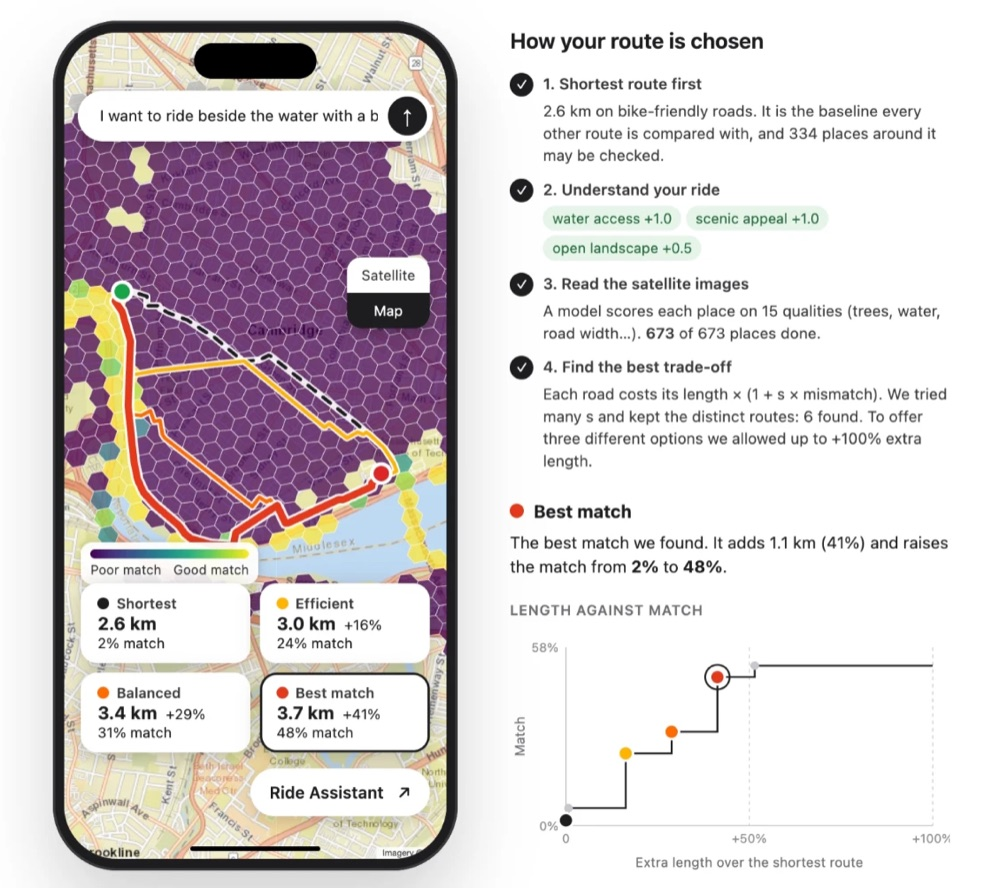

**1. Read the scenery.** A model scores every small hexagonal cell (about 130 m) on 15 qualities between 0 and 1 from its aerial
image: tree canopy, water access, road width, open views, …

**2. Read the ride.** Gemini turns the sentence into a weight per quality, from −1 (avoid) to +1 (want): "beside the water, nice
view" becomes *water access +1, scenic appeal +1, open landscape +0.5*. Each cell then gets a **mismatch** from 0 (fits) to 1 (does not).

**3. Make poor roads feel longer.** Every road gets a cost, and the cheapest route is found with Dijkstra:

```
cost = length × (1 + s × mismatch)
```

`s` is how much extra distance the rider accepts to avoid a poor road. Two ways from A to B:

| | Length | Mismatch | Cost, s = 0 | s = 1 | s = 4 |
|---|---|---|---|---|---|
| Direct, busy road | 1.0 km | 1.0 | **1.0** | 2.0 | 5.0 |
| Detour, along a park | 1.3 km | 0.1 | 1.3 | **1.43** | **1.82** |

Trying many values of `s` gives routes from the shortest to the most scenic. The same start and end, with different rides:

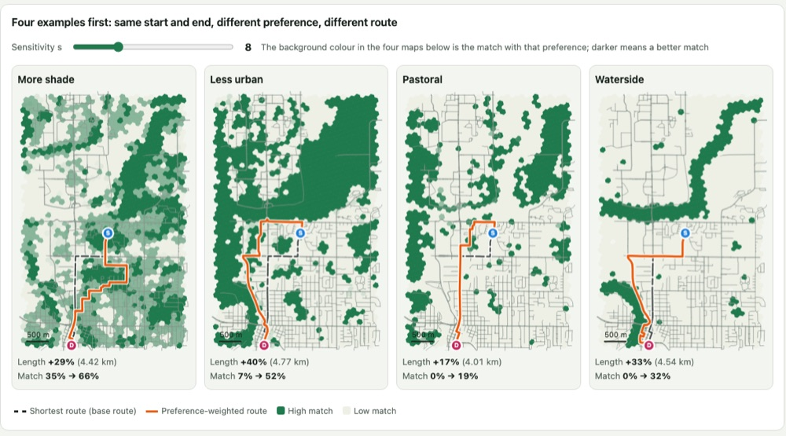

**4. Offer three options**: *Efficient* (least extra distance), *Balanced*, *Best match* (fits best, most extra distance). They run along
different streets (at most 70 % shared), a longer option always fits better, and the allowed extra length widens from +50 % to +100 %
until three exist.

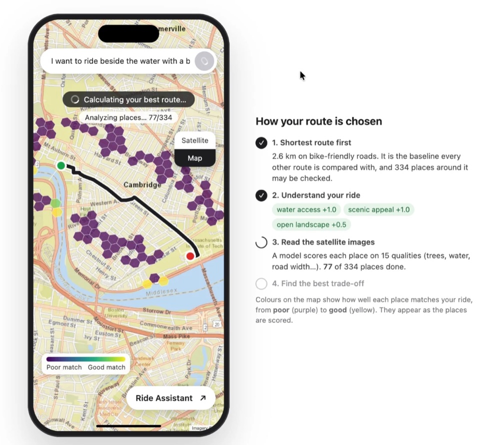

*The model and Gemini run at the same time; each batch of cells is coloured from poor (purple) to good (yellow) as it arrives.*

**Technical notes**

```
Browser ──► Next.js (frontend) ──► API service ──┬─► Model Service (Cloud Run): 15 scores per cell
                                                 ├─► Gemini (Vertex AI): text → weights
                                                 └─► road graph + area baseline (files in the image)
```

| Endpoint | Purpose |
|---|---|
| `POST /route/plan` | Shortest route and the cells to score (instant, no text) |
| `POST /route/stream` | Options for a text, as progress events (newline-delimited JSON) |
| `POST /route` | The same, as one JSON response |

Code: `src/api-service/api/{route_search,road_graph,routing}.py`; data: `src/api-service/data/` (road graph built by `src/routing-graph/`, area baseline); UI: `src/frontend/src/`. Planning takes 0.1–1.3 s; the Model Service dominates (a cold start takes about 40 s). Supported area: Boston, about 5.8 km × 5.6 km. The road graph is undirected and has no bike-lane or elevation data. *Match* is relative to the area, and for wishes few places satisfy (water, farmland) there may be no better route: the options are then marked "other streets". Commands are in "Run the app locally" below; details: `docs/routing.md` and `src/api-service/ROUTING.md`.

### Frontend and backend changes

### Deployment

Everything runs on Cloud Run in `us-central1`: a public frontend, a private API, and a private Model Service and RAG behind it (see "IAM roles" below).

- **Model Service** (`src/model-service`): FastAPI on CPU (4 vCPU, 4 GiB). The image carries the trained weights and the DINOv2 base weights, so it never downloads them at start. Given H3 cells it reads their aerial tiles from the bucket and returns the 15 scores. A parity test checks that 50 validation cells get the same scores as during training (largest difference 0.0024).
- **Parallel scoring**: one instance scores about 6 cells/s and takes one batch at a time, so the API splits a region into up to 30 batches and sends them at once. The API runs as a single instance with one budget of 100 model calls, and the Model Service may scale to 100 instances, so three users can score at full speed. Scoring Boston (2,098 cells) took about 70 s with 10 parallel batches, cold start included; with 3 it would take about 2 minutes.
- **Cold starts**: a new Model Service instance needs 40 to 90 s. While instances start, Cloud Run rejects some batches (HTTP 500), sometimes after holding them for 2 minutes, and one rejected batch used to fail the whole request. The API now retries such batches after 2, 4, 8, then 15 s, up to about 90 s of waiting, which is longer than a cold start.
- **One deploy tool** (`src/deployment`) for the Model Service, API and frontend: their settings sit in one table, the tool sets who may call each service, and it refuses to deploy an API whose budget is larger than the Model Service's instance limit. RAG is deployed from `src/rag-service/deploy`.

## Repository layout

```
src/
├── data-collector/   Collect: H3 cells + aerial tiles (NAIP) + map features (OSM) + street view (Mapillary)
├── data-labeler/     Label: Gemini scores aerial tiles and street photos on 16 dimensions
├── data-processor/   Process: drop suspicious cells, calibrate street scores to the aerial scale, fuse into a training table
├── model-training/   Train: DINOv2-S + linear head, aerial tile in → 15 scores (0–1) out
├── workflow/         Vertex AI pipeline that chains the four steps above in the cloud
├── data-versioning/  DVC snapshots of each training set (table + aerial tiles), stored in gs://<bucket>/dvc_store/
├── model-service/    Model service on Cloud Run: H3 cells in → 15 scores out (FastAPI, CPU)
├── deployment/       Deploy tool for model-service, api-service and frontend on Cloud Run (deploy, test)
├── api-service/      Backend API (FastAPI): preference parsing (Gemini), scoring, route planning
├── rag-service/      Ride Assistant RAG on Cloud Run (rag + chroma containers), deployed from its own deploy/ folder
├── routing-graph/    Offline tool: build the road graph that route planning reads (its output is committed)
└── frontend/         Frontend (Next.js): map, route options, explanation of the chosen route
```

## Data pipeline (runs on Vertex AI)

```
collect → label → process → train
datasets/<DATASET>/  →  training/<TRAINING_ID>/  →  results/<TRAINING_ID>/{dry|final}/<run_id>/best_model.pt
```

- Each step is a container; all data lives in the GCS bucket, and steps hand off through files in the bucket.
- Collect, label, process: our own images, pushed to Artifact Registry with `docker-build-push.sh`.
- Train: Google's prebuilt training image; our code is packaged and uploaded to `gs://<bucket>/trainer/` by `model-training/package-trainer.sh`.
- To change the dataset name, training-set name, areas, or dry run vs. full training, edit only the constants at the top of `src/workflow/cli.py`: `DATASET`, `TRAINING_ID`, `AREAS`, `DRY_RUN`.

## Setup

1. Copy `.env.example` to `.env` (never commit it) and fill in `GREENPATH_BUCKET`, `GOOGLE_CLOUD_PROJECT`, `GOOGLE_CLOUD_LOCATION`, `MAPILLARY_TOKEN`.
2. `gcloud auth login` and `gcloud auth application-default login` (containers use your login credentials; no key file needed).
3. Push images (only after code changes): run `sh docker-build-push.sh` in `data-collector`, `data-labeler` and `data-processor`.
4. Upload the training code (only after it changes): `cd src/model-training && sh package-trainer.sh`.

## Run the pipeline

```
cd src/workflow && sh docker-shell.sh      # enter the workflow container
python cli.py --pipeline                   # collect → label → process → train
python cli.py --data_collector             # or one step: --data_labeler / --data_processor / --model_training
```

Monitor in the GCP console: Vertex AI → Pipelines (the whole run) and Training → Custom jobs (training logs).

## Version the training data (DVC)

After a pipeline run produces a new training set, snapshot it by hand (see `src/data-versioning/README.md`):

```
cd src/data-versioning && sh docker-shell.sh
python cli.py --training-id <TRAINING_ID>   # download the training table + the tiles it uses
dvc add greenpath_dataset && dvc push       # hash it and upload to gs://<bucket>/dvc_store/
```

Then commit `greenpath_dataset.dvc` and tag it `dataset_<TRAINING_ID>` on the Mac.

## Deploy (Cloud Run)

One tool for model-service, api-service and frontend: `src/deployment` (one-time GCP setup is in its README). Push the image of a changed service first with `sh docker-build-push.sh` in that service's folder, then:

```
cd src/deployment && sh docker-shell.sh
python cli.py --prepare                        # model only: copy the trained model into model-service/artifacts/ (before pushing)
python cli.py --deploy --service model         # then api, then frontend (the API refuses if the model has too few instances)
python cli.py --test --service model           # model: scores must match training; api/frontend: add --full to score Boston
```

## Run the app locally

```
docker compose up            # app http://localhost:3000, API docs http://localhost:9000/docs
```

Route planning needs the Model Service (private on Cloud Run) and Gemini (Vertex AI: your gcloud login, no API key). Compose reads `MODEL_SERVICE_URL` (default `http://host.docker.internal:8080`), so start the proxy first, and put the Gemini key in `../secrets/llm-service-account.json` (or set `LLM_PROVIDER=mock`). Without Docker, in three terminals:

```
gcloud run services proxy greenpath-model-service --region us-central1 --port 8080    # 1: keep running
cd src/api-service && GCP_PROJECT=<project-id> MODEL_SERVICE_URL=http://localhost:8080 MODEL_MAX_CONCURRENCY=30 \
  uv run uvicorn api.service:app --port 9000                                          # 2: API
cd src/frontend && API_SERVICE_URL=http://localhost:9000 npm run dev                  # 3: app http://localhost:3000
```

The first request after a quiet period waits for the Model Service to start (about 40 s). Try the API without the app:

```
curl -s -X POST localhost:9000/route/plan -H 'Content-Type: application/json' \
  -d '{"origin":{"lat":42.3467,"lon":-71.0972},"destination":{"lat":42.3588,"lon":-71.0707}}'    # shortest route + cells
curl -s -N -X POST localhost:9000/route/stream -H 'Content-Type: application/json' \
  -d '{"origin":{"lat":42.3467,"lon":-71.0972},"destination":{"lat":42.3588,"lon":-71.0707},"text":"a shady, quiet ride"}'   # progress events, then the routes
```

Check `used_fallback` in the result: `true` means Gemini failed and only the shortest route is returned. Endpoints and options: `src/api-service/ROUTING.md`.

## Build the road graph (only for a new area)

```
cd src/routing-graph
python build_graph.py --city <area_id> --pbf <file>.osm.pbf    # writes src/api-service/data/graphs/<area_id>/
```

The Boston graph (`city_ma_boston_big`) is already in the repository.

## Test and redeploy

```
cd src/api-service && uv run pytest        # backend, including route planning
cd src/frontend && npm test                # proxy and stream reader
```

Deploy api-service and frontend with `src/deployment` (see "Deploy" above); the road graph and baseline are inside the image. The deployed API is private: call it with `-H "Authorization: Bearer $(gcloud auth print-identity-token)"`.

## IAM roles

Each Cloud Run service runs as its own service account and may only be called by the one before it (checked 2026-11-12):

```
user → frontend (public) → API (private) → Model Service, RAG (private)
```

| Component | Runs as (`<name>@<project-id>.iam.gserviceaccount.com`) | Roles | Who may call it |
|---|---|---|---|
| Frontend | `greenpath-frontend` | `run.invoker` on the API | everyone (`allUsers`) |
| API | `greenpath-api-service` | `aiplatform.user` (Gemini); `run.invoker` on Model Service and RAG | only the frontend |
| Model Service | `greenpath-model-service` | `storage.objectViewer` (read the bucket) | only the API |
| RAG | `greenpath-rag-service` | `aiplatform.user`, `serviceusage.serviceUsageConsumer` | only the API |
| Vertex pipeline (collect, label, process, train) | `greenpath-ml-workflow` | `aiplatform.admin`, `iam.serviceAccountUser`, `secretmanager.secretAccessor`, `storage.admin` | – (jobs, not services) |
| RAG image build | `greenpath-rag-builder` | `logging.logWriter` | – |

The browser never calls the API directly: the Next.js server adds a Google ID token. Local runs use your own login (`gcloud auth application-default login`). `python cli.py --deploy` in `src/deployment` sets who may call the Model Service, API and frontend on every deploy; the roles each account needs are granted once by hand. To check:

```
gcloud run services get-iam-policy <service> --region us-central1
gcloud projects get-iam-policy <project-id> --flatten="bindings[].members" --filter="bindings.members:greenpath" \
  --format="table(bindings.members,bindings.role)"
```
