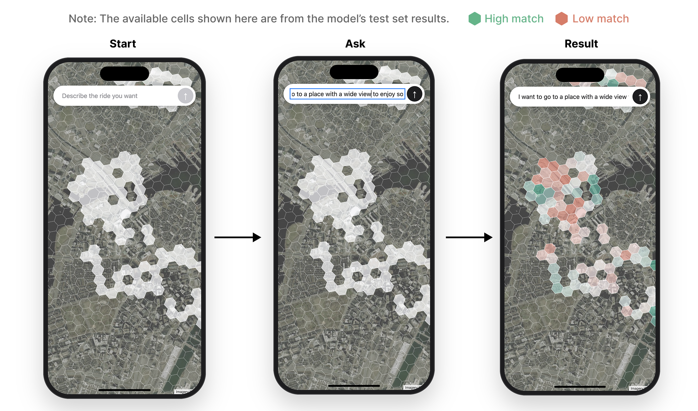
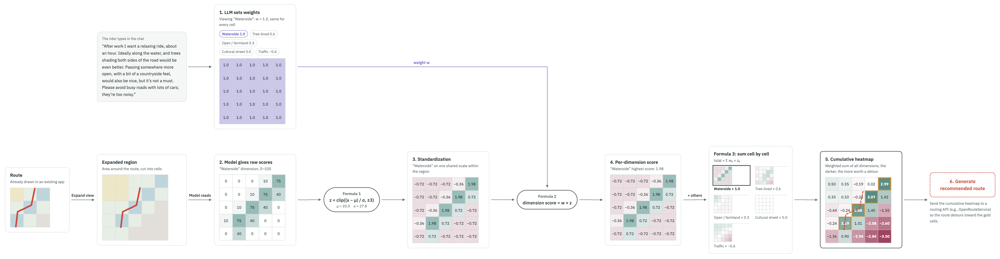
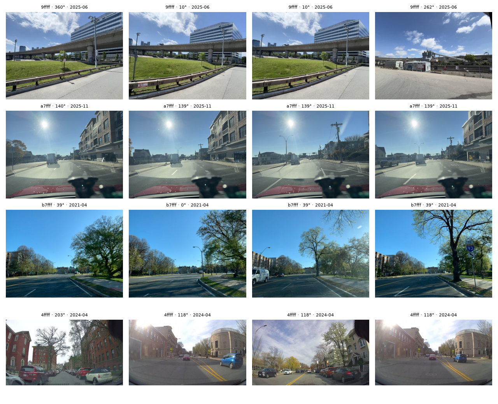
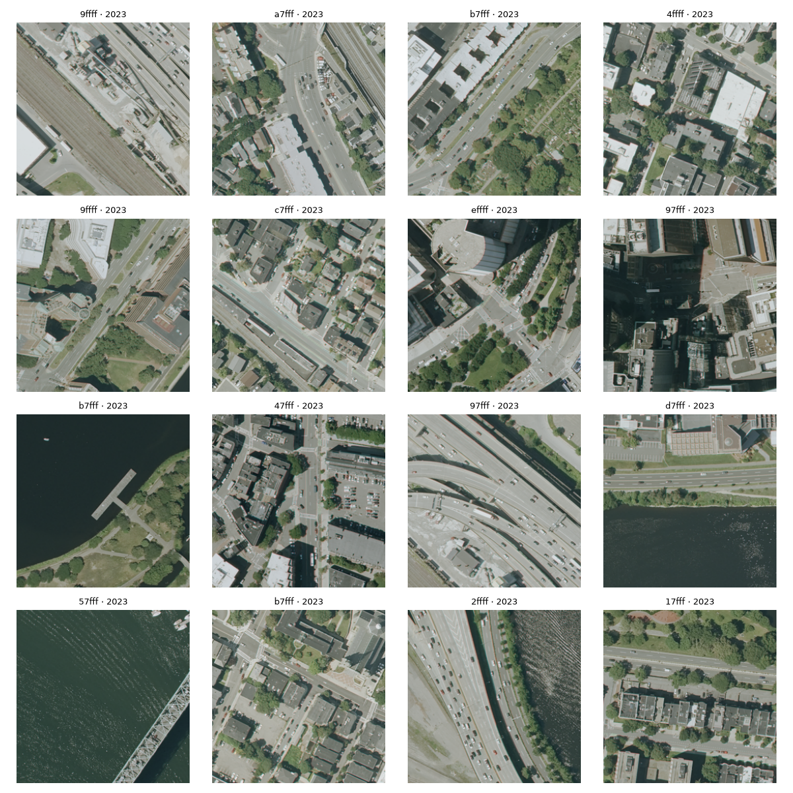
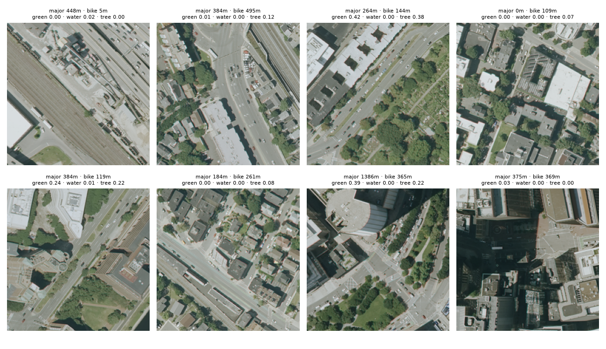
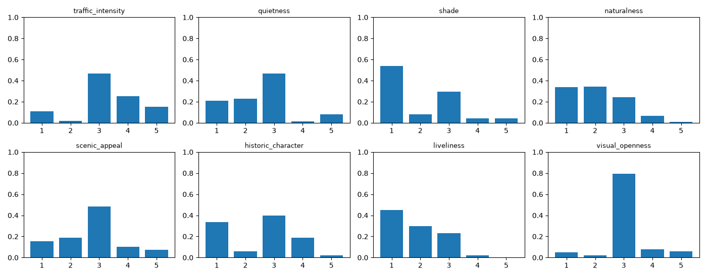
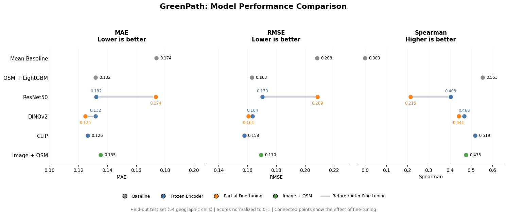
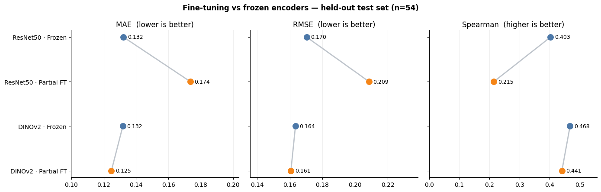
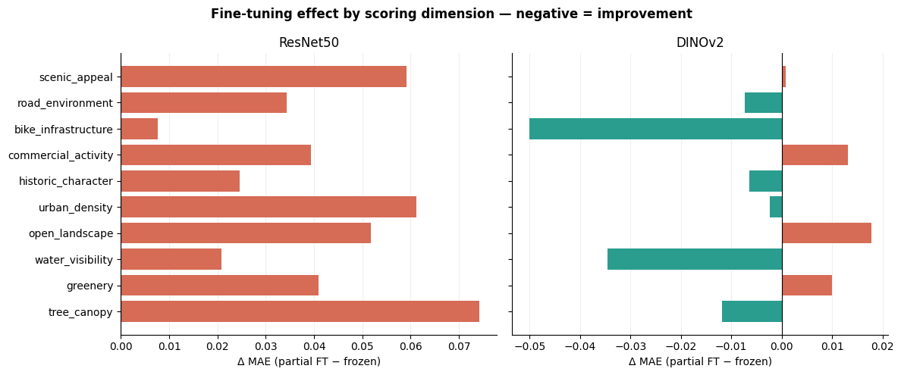
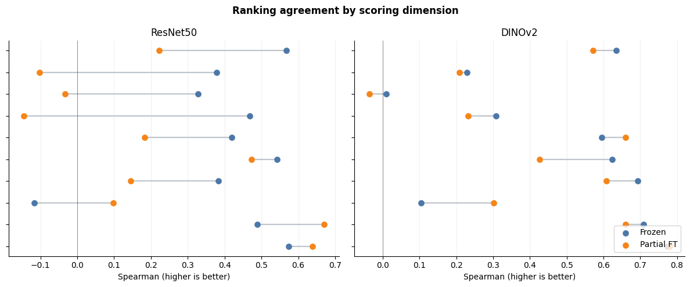

# GreenPath

GreenPath aims to personalize cycling routes around the scenery and street environment
riders want to experience, complementing route planners focused on feasibility and
popularity. We use street-view images to generate training labels and train a vision
model to predict multidimensional experience scores from aerial imagery. Our Boston MVP lets
riders describe their preferences and explore matching areas on a map; route adjustment
is the next step. **Milestone 2 track: Vision.**

## Contents

- [Repository at a glance](#repository-at-a-glance)
- [Quick Start: try the MVP](#quick-start-try-the-mvp)
- [API Service](#api-service)
  - [Application directory](#application-directory)
  - [Run and try](#run-and-try)
  - [Using the real Gemini](#using-the-real-gemini)
  - [Backend modules](#backend-modules)
  - [Result versions](#result-versions)
  - [FAQ](#faq)
- [Frontend](#frontend)
  - [Planned Route Recommendation](#planned-route-recommendation)
- [ML Pipeline](#ml-pipeline)
  - [Run collection through prediction](#run-collection-through-prediction)
  - [Example pipeline outputs](#example-pipeline-outputs)
  - [Model training and results: partial fine-tuning](#model-training-and-results-partial-fine-tuning)
  - [Data and model versions](#data-and-model-versions)

## Repository at a glance

Two connected parts: the **ML pipeline builds a model and saves predictions**; the
**application reads those predictions and matches them to riding preferences**.

```text
src/
├── data-collector/   Collection, preprocessing and teacher labels
├── data-processor/  Dataset preparation and spatial splits
├── feature-encoder/ Fixed CLIP image features
├── model-training/  Ridge training and model export
├── model-deploy/    Reload, predict and package a serving bundle
├── ml-workflow/     Pipeline orchestration and artifact management
├── api-service/     FastAPI: preferences + saved predictions → map scores
└── frontend-app/    Next.js: preference input and interactive H3 map
```

```text
Street views + aerial images + geographic data
  → five ML containers → saved serving bundle → API → frontend map
                                               ↑
                                         user preferences
```

Docker Desktop supplies the local Linux VM. Python containers use `pyproject.toml` and
`uv.lock`; the frontend uses `npm ci`. Compose defines services; Python orchestrates ML jobs.

## Quick Start: try the MVP

Requires Git, make and a running Docker Desktop (or Docker Engine with Compose v2).
Keep ports **3000/9000** free. Internet is needed for builds and map imagery.

```sh
git clone --branch milestone2 https://github.com/XiaozaoWang/AC215_GreenPath.git
cd AC215_GreenPath
cp .env.example .env
make app
```

Wait for the API and frontend to finish starting; keep the terminal running.
Open **http://localhost:3000** and enter **`I want a quiet ride with open views`**.
API documentation: **http://localhost:9000/docs**. Stop with `docker compose down`.
The demo reads bundled predictions for 188 historical test cells and uses local keyword
parsing; no cloud credentials are needed. It does not run the ML pipeline or the ten-target
fine-tuning experiment described below.

## API Service

The user describes the riding style they want in one sentence. The backend asks Gemini
to turn this preference into weights (by default it uses a keyword stand-in), combines
those weights with the vision model's saved results, and highlights the best-matching
areas on the map.

**The frontend and backend do not run the vision model.** They read a result bundle
computed in advance: cell shapes, per-cell scores and dimension definitions. A replacement
model can use the same integration when its bundle follows the supported format and schema.

### Application directory

```text
src/
├── api-service/                      Backend (FastAPI, port 9000)
│   ├── api/                          Code
│   ├── fixtures/                     Bundled result: 188 test cells
│   └── tests/                        Unit tests
└── frontend-app/                     Frontend (Next.js, port 3000)
    └── src/
        ├── app/page.jsx              Page: iPhone mockup + input box
        ├── components/HexMap.jsx     Map: satellite basemap + H3 hexagons
        └── services/DataService.js   Calls the backend
```

### Run and try

Follow [Quick Start](#quick-start-try-the-mvp) to start both services with `make app`.
Open **http://localhost:3000** and enter **`I want a quiet ride with open views`**.
Inspect or try API requests at **http://localhost:9000/docs**.

### Using the real Gemini

The default keyword stand-in only recognizes fixed keywords. For broader natural-language
understanding, use Gemini with an authorized project and billing enabled.

Add to `.env`:

```dotenv
COMPOSE_FILE=docker-compose.yml:docker-compose.gcp.yml
LLM_PROVIDER=gemini
```

**Option 1: team project (recommended).** Requires Vertex AI access on the team project;
usage is billed to that project. If `ADC_FILE` is set in `.env`, it must point to your
valid credentials; otherwise Compose uses the default local ADC file.

```sh
gcloud auth application-default login
gcloud auth application-default set-quota-project organic-victory-508017-v9
docker compose up --build
```

**Option 2: your own project.** Enable Vertex AI and billing on your project, and set:

```dotenv
GCP_PROJECT=your-project-id
# Optional: only set this when using an existing authorized credential file.
# ADC_FILE=/full/path/to/your-service-account-key.json
```

Without a credential file, leave `ADC_FILE` unset and authenticate locally:

```sh
gcloud auth application-default login
gcloud auth application-default set-quota-project YOUR_PROJECT_ID
docker compose up --build
```

Never commit `.env` or credentials to Git.

### Backend modules

| File | Role |
| --- | --- |
| `agent.py` | Asks Gemini and checks the format; retries invalid replies and falls back to all-zero weights after three failures. |
| `llm.py` | Calls Gemini; `LLM_PROVIDER` switches between Gemini and the stand-in. |
| `prompts.py` | Gemini instructions: dimensions and weighting rules. |
| `fake_llm.py` | Offline keyword stand-in; no key needed. |
| `schemas.py` | Data format definitions and validation. |
| `dimensions.py` | Reads the dimension table. |
| `tiles.py` | Returns the cells for a region. |
| `model_client.py` | Reads per-cell scores and checks one-to-one cell alignment. |
| `score_math.py` | Standardizes scores, clips extremes, applies weights and must-have thresholds. |
| `pipeline.py` | Runs the modules in order. |
| `service.py` | FastAPI entry point and endpoints. |
| `routers/score.py` | Receives preference/scoring requests and returns results. |
| `routers/source.py` | Read-only backend source viewer endpoint. |
| `model_bundle.py`, `versions.py`, `artifacts.py` | Load bundles, resolve versions, and provide GCS transfer utilities. |

### Result versions

A fresh checkout shows the bundled 188 cells. After `make run` trains a model, the new
result becomes the default. To return to the bundled result:

```sh
make app-versions APP_ARGS="--version boston-heldout-en-v2"
```

### FAQ

| Symptom | Cause / fix |
| --- | --- |
| The map does not change after input | Try the example keywords; the stand-in does not understand every phrasing. With Gemini, check logs for `LLM call failed`. |
| Credentials not found | Check that `docker-compose.gcp.yml` is included through `COMPOSE_FILE`, and that the ADC file exists and is mounted. |
| Port already in use | Stop the containers owning the port. For this app, run `docker compose down` before restarting. |

## Frontend

Next.js/React + Leaflet provides a phone-style prompt box and zoomable H3 map. It calls
`/preview` on load and `/score` on submission; colored cells have predictions and gray
cells do not. After Quick Start, enter a preference at **http://localhost:3000**.
[Frontend files and configuration](src/frontend-app/README.md).



Start with the map, enter a riding preference, and view matching areas. This example
uses saved predictions from the historical held-out test set.

### Planned Route Recommendation

The next step is to use the preference-weighted heatmap to adjust an existing cycling
route toward matching areas, through a routing service. The current MVP implements
preference weighting and map display; route input, adjustment and generation are not
implemented yet.



The diagram uses earlier example dimensions and score scales; the current model has
eight raw outputs in [0,1]. Its final routing step illustrates the planned extension.

## ML Pipeline

### Run collection through prediction

Run the complete **50-cell pilot**, from collection and labeling to training, saved
predictions and the app. Requires Docker (about 8 GiB memory), Python 3.9+, make and
Google Cloud CLI. Ask the team for **Vertex AI access and GCS read access**, and obtain
a Mapillary Client Token. New labeling makes paid Vertex AI requests.

1. After the repository setup above, authenticate your own Google account:

   ```sh
   gcloud auth application-default login
   gcloud auth application-default set-quota-project organic-victory-508017-v9
   ```

   Set these values in `.env` (replace the token and ADC path):

   ```dotenv
   GOOGLE_CLOUD_PROJECT=organic-victory-508017-v9
   GOOGLE_CLOUD_LOCATION=us-central1
   ADC_FILE=/absolute/path/to/.config/gcloud/application_default_credentials.json
   MAPILLARY_TOKEN=YOUR_MAPILLARY_CLIENT_TOKEN
   ```

2. If the app above is running, stop it first with `docker compose down` to free
   ports 3000/9000. Then run:

   ```sh
   make run-all WORKFLOW_ARGS="--run-id reviewer-pilot-001 --allow-labeling"
   ```

   The command builds and coordinates five ML container roles in order:

   | Container / code folder | Responsibility |
   | --- | --- |
   | `data-source` / [`src/data-collector/`](src/data-collector/) | 01–04: collect street views, crop aerial tiles, extract geographic features and generate teacher labels. |
   | [`data-processor`](src/data-processor/) | Freeze inputs, then join/filter data and create spatial train/val/test splits (05). |
   | [`feature-encoder`](src/feature-encoder/) | Extract fixed CLIP image features (06). |
   | [`model-training`](src/model-training/) | Fit and export scaler + Ridge models (07). |
   | [`model-deploy`](src/model-deploy/) | Reload the model, predict and package the geographic serving bundle. |

3. Open **http://localhost:3000** to view the new predictions. Check `success: true`
   in `.artifacts/workflows/reviewer-pilot-001/workflow-summary.json`. Outputs are in
   `.artifacts/pipeline/runs/<training_run_id>/`; the summary identifies that ID.

Use a new run ID for another run. Valid source outputs may be reused. If labeling stops
with images pending, rerun the same command with `--resume` added inside `WORKFLOW_ARGS`.
[Detailed pipeline instructions](docs/ML_PIPELINE.md#execution-and-resuming).

### Example pipeline outputs

Saved outputs from the completed `boston-pilot-v2` run, generated by the upstream
`data-source` container (01–04):

| 01 · Street-view collection | 02 · Aerial image preprocessing |
| --- | --- |
|  |  |
| Multiple street views per cell provide teacher-label inputs. | Each RGB tile is 256 × 256 pixels, covering approximately 154 × 154 m. |

| 03 · Geographic features | 04 · Teacher labels |
| --- | --- |
|  |  |
| OSM / WorldCover road lengths and land-cover fractions. | Image-level scores from 1–5; these are label distributions, not model accuracy. |

Street imagery © Mapillary contributors, CC BY-SA 4.0. Aerial imagery: USDA NAIP via
Microsoft Planetary Computer. Geographic data: © OpenStreetMap contributors (ODbL)
and ESA WorldCover 2021 (CC BY 4.0).

### Model training and results: partial fine-tuning

**Notebook 08 compares models predicting ten scenery scores.** These are research
results; the app still uses its existing frozen CLIP + Ridge model.

**Question: does fine-tuning help?** We compare keeping pretrained image encoders
unchanged (frozen) with updating their final layers (partial fine-tuning). All models
use the same data split and Gemini-generated labels, which have not been human-validated.

#### 1. Data and evaluation protocol

After filtering, **160 cells** remain: **67 train, 39 validation and 54 test**.
Ten scores cover trees, greenery, water, openness, urban density, historic character,
commercial activity, cycling infrastructure, road environment and scenic appeal (0–1).

Validation error selects the model checkpoint; test cells are reserved for evaluation.
Metrics average the ten targets and ignore missing labels:
**MAE** is average absolute error, **RMSE** emphasizes large errors (both lower is better),
and **Spearman** measures agreement in area rankings (higher is better).

#### 2. Model configurations

| Component | M2a: ResNet50 Partial FT | M2b: DINOv2-S Partial FT |
|---|---|---|
| Pretrained encoder (`timm`) | `resnet50.a1_in1k` | `vit_small_patch14_dinov2.lvd142m` |
| Frozen encoder layers | All except final residual stage | All except last two Transformer blocks and final norm |
| Trainable encoder layers | `layer4` | `blocks[-2:]` and `norm` |
| Regression head | New linear head with 10 outputs + sigmoid | New linear head with 10 outputs + sigmoid |
| Trainable parameters (from Notebook 08 output) | 14,985,226 / 23,528,522 (**63.7%**) | 3,555,082 / 21,632,650 (**16.4%**) |
| Optimizer | AdamW | AdamW |
| Learning rate | Encoder `1e-5`; head `3e-4` | Encoder `1e-5`; head `3e-4` |
| Weight decay | `1e-4` | `1e-4` |
| Loss | Masked SmoothL1 / Huber (`beta=0.1`) | Same |
| Image processing | 224×224 center crop; ImageNet normalization; random flips and 90° rotations | Same |
| Batch size / maximum epochs | 8 / 25 | 8 / 25 |
| Early stopping | Patience 6; select minimum validation MAE | Same |

ResNet50 ran for 25 epochs; DINOv2 stopped early after 15. Saved checkpoints were
reloaded for evaluation. Training uses mixed precision when available and gradient clipping.

**Comparison limit:** frozen models use Ridge; fine-tuned models use a new neural head.
Because both the encoder and head change, differences are not due only to fine-tuning.

#### 3. Held-out test comparison (54 cells)

| Model | MAE ↓ | RMSE ↓ | Spearman ↑ |
|---|---:|---:|---:|
| B0: Mean baseline | 0.174 | 0.208 | 0.000 |
| B1: OSM + LightGBM | 0.132 | 0.163 | **0.553** |
| ResNet50 — Frozen + Ridge | 0.132 | 0.170 | 0.403 |
| ResNet50 — Partial FT | 0.174 | 0.209 | 0.215 |
| DINOv2-S — Frozen + Ridge | 0.132 | 0.164 | 0.468 |
| DINOv2-S — Partial FT | **0.125** | 0.161 | 0.441 |
| CLIP — Frozen + Ridge | 0.126 | **0.158** | 0.519 |
| M3: Image + OSM | 0.135 | 0.170 | 0.475 |



*Figure 1. Connected points show before/after fine-tuning; leftward is better for error, rightward for ranking.*

##### Frozen vs partial fine-tuning: direct comparison

| Encoder | Frozen MAE | FT MAE | Δ MAE ↓ | Frozen RMSE | FT RMSE | Δ RMSE ↓ | Frozen Spearman | FT Spearman | Δ Spearman ↑ |
|---|---:|---:|---:|---:|---:|---:|---:|---:|---:|
| ResNet50 | 0.132 | 0.174 | **+0.042** | 0.170 | 0.209 | **+0.039** | 0.403 | 0.215 | **−0.188** |
| DINOv2-S | 0.132 | 0.125 | **−0.007** | 0.164 | 0.161 | **−0.003** | 0.468 | 0.441 | **−0.027** |

DINOv2 reduces error but worsens ranking. ResNet50 worsens on all three metrics.
These observed differences are not claims of statistical significance.



*Figure 2. Each encoder before and after fine-tuning.*

#### 4. Detailed comparison by target dimension

The next two figures show which individual targets improve or worsen, rather than
only reporting an overall average.

##### Change in MAE



*Figure 3. Error change after fine-tuning: negative = improved, positive = worse.*

##### Ranking agreement



*Figure 4. Ranking agreement for each target; higher is better.*

Detailed CSV output names are listed in the [full report](docs/experiments/finetuning/FINETUNING.md).

#### 5. Interpretation and limitations

- **DINOv2-S:** lowest MAE (0.125), but ranking agreement decreases.
- **ResNet50:** fine-tuning performs worse than its frozen baseline.
- **Frozen CLIP:** lowest RMSE (0.158), without updating the encoder.
- **OSM + LightGBM:** best ranking agreement (Spearman 0.553).

Only 67 training cells and unverified teacher labels limit these findings. Aerial images
also cannot capture everything visible from the street. Next: human-check labels, expand
data beyond Boston, and compare frozen/fine-tuned encoders with the same head design.

#### 6. Reproducibility

Run notebooks 05 → 06 → 07 → [08](docs/experiments/finetuning/08_finetuning.ipynb) with
the matching ten-target data. Notebook 08 uses Google Colab/T4 and Google Drive, saving
checkpoints, metrics, settings and plots under `data/results/finetuning-*/`.

[Full report and settings](docs/experiments/finetuning/FINETUNING.md). Notebook and figures
are included; raw CSVs/checkpoints are not. This dataset is separate from the app's bundled data.

### Data and model versions

We separate **reusable inputs** from **individual training results**:

- `.artifacts/sources/<source-version>/`: resumable collection and label workspace.
- `.artifacts/snapshots/sources/<snapshot-version>/`: frozen input reused for training.
- `.artifacts/pipeline/runs/<run-id>/`: prepared data, embeddings, model, predictions,
  serving and logs for one run. New runs use new directories.

Checksummed manifests link source, dataset, encoder and model versions across containers.
`model/weights.npz` saves scaler/Ridge parameters; `serving/` packages predictions,
geometry and provenance. Explicit publication shares artifacts through
`gs://ac215-greenpath/artifacts/`; credentials and caches stay out of Git.
[Storage layout and version tracking](docs/DATA_AND_MODEL_VERSIONING.md).
