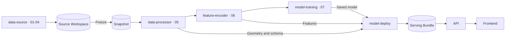

# ML Pipeline

## What was implemented

Research notebooks 01-07 were extracted into Python components. The integration adds
locked container environments, immutable input snapshots, reloadable scaler/Ridge models,
batch prediction, an eight-target geographic serving contract and app result selection.
The app's simulated scores were replaced with real model predictions.

## Containers and code

| Container service | Code directory / main modules | Notebook responsibility |
| --- | --- | --- |
| `data-source` | `src/data-source/greenpath_source/`: `streetview.py`, `tiles.py`, `features.py`, `labeling.py` | 01-04 acquisition, preprocessing and teacher labels; one shared image/container |
| `data-processor` | `src/data-processor/greenpath_data/`: `dataset.py`, `snapshot.py` | 05 joins, filtering, spatial splits; snapshot utilities |
| `feature-encoder` | `src/feature-encoder/greenpath_encoder/encode.py` | 06 fixed CLIP image features |
| `model-training` | `src/model-training/greenpath_training/train.py` | 07 selected scaler + Ridge baseline |
| `model-deploy` | `src/model-deploy/greenpath_model/region.py` and prediction utilities | Independent model reload, batch prediction and serving packaging |

Notebook originals and English counterparts are in [notebooks/](notebooks/README.md).
The container path does not rerun every experimental model in notebook 07.



Freeze is a separate temporary task using the data-processor image. ML jobs exit after
completion; API/frontend remain running. Serving contains predictions, not an online
image-inference server. [Versioning](DATA_AND_MODEL_VERSIONING.md) explains the files.

## Compose and orchestration

| Main YAML | Services | Optional supplement |
| --- | --- | --- |
| `docker-compose.sources.yml` | One `data-source` service, sequential 01-04 | `.sources.gcp.yml`: ADC for paid labeling |
| `docker-compose.ml.yml` | Four downstream ML jobs | `.ml.gcp.yml`: ingestion ADC; `.ml.local.yml`: local snapshot |
| `docker-compose.yml` | API and frontend | `.gcp.yml`: ADC and on-demand artifact tools |

Supplement names above share the `docker-compose` prefix. Matching service names merge
settings when loaded with `-f`; they do not each create another pipeline.

`tools/run_all.py` invokes one upstream job, freezes the snapshot, then calls
`tools/run_pipeline.py`. The latter runs the four ML jobs, validates artifacts, registers
serving and starts/checks the app. Thus one Make command coordinates several Compose
invocations. Inside the ML group, `service_completed_successfully` enforces order.

Every Python component has a Dockerfile, `pyproject.toml`, `uv.lock` and `.python-version`.
Images install pinned uv 0.12.12 and frozen runtime dependencies in `/opt/venv`.
The source image installs `--all-extras`; downstream packages use separate locks.
ML/source Python is 3.11; API Python is 3.12. See [dependency details](DEPENDENCIES.md).

## Execution and resuming

Use the [root README](../README.md) for the three main entry points. All commands below
also run from the repository root:

```sh
make source-build
# One upstream container; permit at most 8 new labeled images, excluding retries.
make collect-sources SOURCE_ARGS="--allow-labeling --max-images 8"

# Individual stages from the same shared image, when needed.
make collect-streetview
make collect-tiles
make collect-features
make label-images SOURCE_MAX_IMAGES=1
make label-report
```

These are alternatives for diagnosis, not prerequisites to repeat before run-all.
`collect-sources` uses the ADC supplement. Standalone stages create separate temporary
instances of the same image. A direct 01 rerun after 02 is refused to protect the cell table;
the combined `all` command instead skips verified completed stages.

- Config: `configs/source-boston.example.json`; full workflow: `configs/workflow-boston-small.json`.
- One source lock covers 01-04. Cached paid results are saved per image; a bounded partial
  batch stops before freezing and can be resumed explicitly. Retries can add requests.
- Source config changes need a new workspace/version; training run IDs must be unique.
- Failed stages stop downstream work. Small pilots may fail strict spatial split checks.
- Upstream summary: `sources/<source-version>/source-run-summary.json`; stage manifests:
  `sources/<source-version>/runs/<timestamp>/`; workflow log: `workflows/<id>/logs/01-04_sources.log`.
  All are under `.artifacts/`.

## Evidence and current boundary

[Recorded smoke evidence](pipeline/evidence/run-summary.json) shows GCS ingestion, fresh
48-image encoding, training, independent reload, prediction and app verification.
Its [sample input](pipeline/evidence/sample-request.json) and
[response preview](pipeline/evidence/sample-response-preview.json) show the API contract;
full current responses are saved in each local run's `sample-response.json`.

The newer [boston-pilot-v2 workflow summary](pipeline/evidence/boston-pilot-v2/workflow-summary.json)
and [run summary](pipeline/evidence/boston-pilot-v2/run-summary.json) verify the consolidated
source-to-app path on 2026-10-19. 01-04 completed with 193 labeled street photos and 50
labeled cells; a year-gap filter left 49 cells (31/10/8). Independent model reload and
API/frontend checks passed. The map response includes all 49 cells, not only the test split.

See the [upstream log](pipeline/evidence/boston-pilot-v2/01-04_sources.log),
[ML log](pipeline/evidence/boston-pilot-v2/ml.log),
[sample request](pipeline/evidence/boston-pilot-v2/sample-request.json) and
[response](pipeline/evidence/boston-pilot-v2/sample-response.json).
This validates the pilot workflow, not full-size collection or model generalization.
No jobs or tests were rerun while updating these documents. See [experiments](EXPERIMENTS.md).
