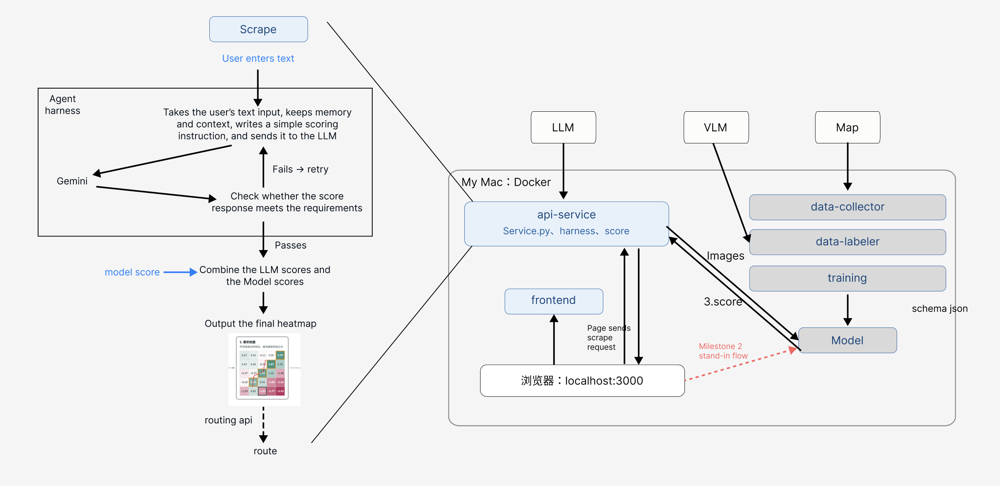
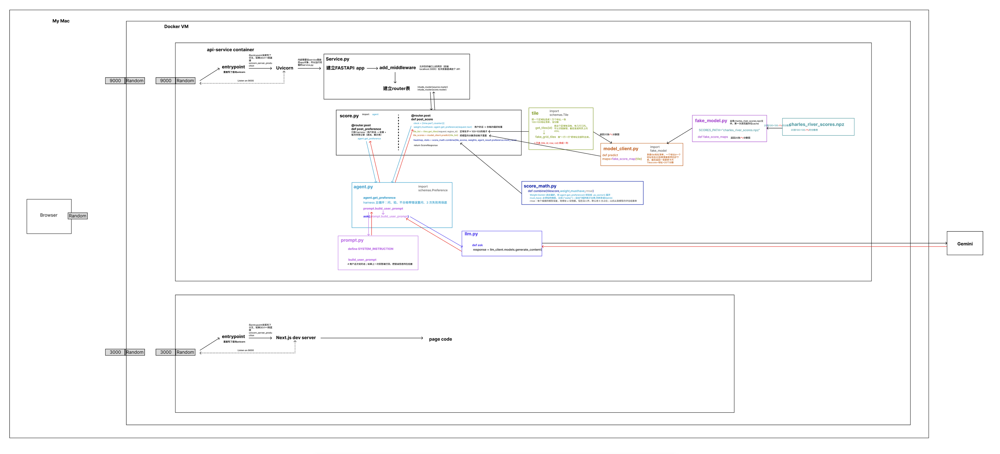

> Archived 20-dimension simulated demo. Use `MODEL_PROVIDER=legacy`; current defaults are described in `../STEP1.md`.



# SmartPath: Personalized Scenic Cycling (AC215 · Milestone 2)

SmartPath turns a cyclist's free-text description of the scenery they want
("ride along the river, shade if possible, avoid traffic") into a **scenery heatmap**
over a 100 × 100 grid of tiles. Later milestones use this heatmap to re-route bike trips.

This repo contains the **app side** of Milestone 2: `api-service` (FastAPI + Gemini harness + scoring)
and `frontend` (Next.js heatmap page). Data collection, VLM labeling and model training are built
by teammates in separate containers. They plug in through the data contract described below.

---

## Contents

- [Milestone 2 scope: what is real, what is fake](#milestone-2-scope-what-is-real-what-is-fake)
- [Architecture](#architecture)
- [Repository layout](#repository-layout)
- [Prerequisites](#prerequisites)
- [Run everything with one command](#run-everything-with-one-command)
- [Run without a Gemini key (offline mode)](#run-without-a-gemini-key-offline-mode)
- [Running on Windows](#running-on-windows)
- [Develop one container at a time](#develop-one-container-at-a-time)
- [API endpoints](#api-endpoints)
- [How a request is processed](#how-a-request-is-processed)
- [Contracts with teammates](#contracts-with-teammates)
- [Fake model scores from a satellite image](#fake-model-scores-from-a-satellite-image)
- [Tests](#tests)
- [Data and version tracking](#data-and-version-tracking)
- [Evidence (logs + sample input → output)](#evidence-logs--sample-input--output)
- [Next steps](#next-steps)

---

## Milestone 2 scope: what is real, what is fake

| Part | Status | Where |
|---|---|---|
| Preference parsing with Gemini (Vertex AI) + harness (validate, retry with error, fallback) | **real** | `api-service/api/agent.py`, `llm.py`, `prompts.py` |
| Data contracts (pydantic) | **real** | `api-service/api/schemas.py` |
| Scoring math (region z-score, σ floor, clip, t = Z·w, must_have gate) | **real**, unit-tested | `api-service/api/score_math.py` |
| Web app: sidebar · heatmap + prompt · pipeline inspector (no page scroll) | **real** | `frontend/src/app/page.jsx`, `frontend/src/components/` |
| One-command app (`docker compose up`) | **real** | `docker-compose.yml` |
| Region / tiles (100 × 100 grid over one satellite image of the Charles River, Harvard / Allston) | **fake** | `tiles.py` → `FAKE_REGIONS`, `fake_grid_tiles()` |
| Model scores, simulated from that satellite image (pixel color analysis + hand annotations, precomputed) | **fake** | `fake_model.py`, `scripts/fake_scores_from_image.py`, `data/fake/` |
| Model RMSE used as σ floor (5 points) | **placeholder** | `score_math.py` → `PLACEHOLDER_RMSE` |
| 20 scenery dimensions | **placeholder names** | `dimensions.py` |
| Routing | not in M2 | — |

Anything fake has `fake` / `FAKE` / `PLACEHOLDER` in its name, so it is easy to find and replace.

---

## Architecture

```
┌──────────── Cloud ─────────────────────────────┐
│  Gemini on Vertex AI (gemini-3.1-flash-lite)   │
│  GCS bucket (shared, used by data/model team)  │
└────────────────────────────────────────────────┘
          ▲ service-account key mounted read-only
┌──────────── Laptop: docker compose (smartpath-network) ─────────────────┐
│                                                                         │
│  frontend (Next.js, :3000)          api-service (FastAPI, :9000)        │
│  serves the page; the page's JS ──▶ routers/score.py                    │
│  in the browser calls :9000          ├─ agent.py   ②–⑤ harness → Gemini │
│                                      ├─ tiles.py   ⑥⑦ region → tiles    │
│                                      ├─ model_client.py ⑧⑨ tile scores  │
│                                      └─ score_math.py   ⑩ heatmap       │
└─────────────────────────────────────────────────────────────────────────┘
```

---

## Repository layout

```
.
├── docker-compose.yml          # one command: docker compose up --build
├── .env.example                # environment variables you may set (copy to .env)
├── .gitattributes              # keeps .sh files LF so containers start on Windows too
├── api-service/
│   ├── Dockerfile              # python:3.12-slim + uv (venv at /.venv)
│   ├── pyproject.toml, uv.lock # dependencies (uv)
│   ├── docker-shell.sh         # dev: build + open a shell in the container
│   ├── docker-entrypoint.sh
│   ├── api/
│   │   ├── service.py          # FastAPI app, CORS, routers
│   │   ├── routers/score.py    # POST /preference, POST /score (thin: calls pipeline)
│   │   ├── pipeline.py         # the request flow: agent → tiles → model → score math
│   │   ├── routers/source.py   # GET /source (read-only backend code viewer)
│   │   ├── dimensions.json     # the 20 scenery dimensions + version + score range (shared with teammates)
│   │   ├── dimensions.py       # reads dimensions.json
│   │   ├── schemas.py          # pydantic data contracts
│   │   ├── prompts.py          # Gemini instructions
│   │   ├── llm.py              # one LLM call; LLM_PROVIDER switches Gemini / mock
│   │   ├── fake_llm.py         # FAKE: offline keyword stand-in for Gemini (no key needed)
│   │   ├── agent.py            # harness loop
│   │   ├── tiles.py            # region → tiles (fake demo grid)
│   │   ├── model_client.py     # tiles → scores (calls fake_model for now)
│   │   ├── fake_model.py       # FAKE: loads the precomputed scores from data/fake/
│   │   └── score_math.py       # scoring math
│   ├── scripts/fake_scores_from_image.py  # FAKE: satellite image → simulated 20-dim scores
│   ├── data/fake/              # satellite image, generated scores (.npz), preview image
│   └── tests/                  # test_score_math.py, test_agent.py, test_model_client.py
├── frontend/                   # Next.js 14 (from the course tutorial, cheese pages removed)
│   ├── Dockerfile.dev, docker-shell.sh
│   ├── src/app/page.jsx        # three-column app layout
│   ├── src/components/         # layout/Sidebar, heatmap/{Heatmap,Legend}, pipeline/Inspector
│   └── public/seas-logo.svg    # logo placeholder (replace with the official Harvard SEAS logo)
└── docs/m2-evidence/           # logs + sample input/output
```

---

## Prerequisites

1. **Docker Desktop** running.
2. A GCP project with the **Vertex AI API** enabled (we use `ac215-507902`).
3. A service account with the **Vertex AI User** role, and its JSON key saved **outside the repo**:

```
parent-folder/
├── Smartpath/          ← this repo
└── secrets/
    └── llm-service-account.json
```

The key is only mounted into the container at runtime (`../secrets:/secrets:ro`). It is never copied into an image or committed to git. `secrets/` is also listed in `.gitignore`.

---

## Run everything with one command

From the repo root:

```bash
docker compose up --build
```

- Page: http://localhost:3000
- API docs (try the endpoints in the browser): http://localhost:9000/docs

The first start takes about 30 s, because the frontend runs `npm install`. To use a different GCP project:
`GCP_PROJECT=my-project docker compose up --build`.

Stop everything:

```bash
docker compose down
```

After editing backend code, run `docker compose restart api-service`. The code is mounted, so no rebuild is needed.
The frontend hot-reloads on its own.

---

## Run without a Gemini key (offline mode)

Teammates without the service-account key, and tests or CI, can run everything with a local stand-in for Gemini:

```bash
LLM_PROVIDER=mock docker compose up --build
```

Or copy `.env.example` to `.env` and set `LLM_PROVIDER=mock` there (`.env` is not committed).

- `api/fake_llm.py` reads keywords (English and Chinese) and returns the same JSON format as Gemini, so the harness,
  validation, heatmap and page all run normally.
- It only matches keywords: "想沿着河骑，最好有树荫，别有太多车" gives `water +1`, `tree_canopy +0.6`, `traffic −1`,
  but it has no associations or real understanding. Use Gemini (`LLM_PROVIDER=gemini`, the default) for demos.
- The Gemini client is only created on the first real Gemini call, so mock mode needs no `GCP_PROJECT` and no key.

---

## Running on Windows

Use PowerShell with Docker Desktop running. The commands are the same:

```powershell
docker compose up --build
docker compose ps
docker compose down
```

- Offline mode in PowerShell: `$env:LLM_PROVIDER="mock"; docker compose up --build` (or use a `.env` file).
- `.sh` files must keep LF line endings or the containers fail to start. `.gitattributes` makes git check them out
  with LF on every machine. If you created the files before `.gitattributes` existed, run
  `git add --renormalize .` once.
- Put the key at `..\secrets\llm-service-account.json` (next to the repo folder), same as on Mac.

---

## Develop one container at a time

Same pattern as the course tutorial: build the image and open a shell inside the container.

```bash
cd api-service && sh docker-shell.sh     # then run: uvicorn_server   (auto-reload on code change)
cd frontend && sh docker-shell.sh        # then run: npm install && npm run dev
```

---

## API endpoints

| Method | Path | What it does |
|---|---|---|
| GET | `/` | health check |
| POST | `/preference` | text → validated preference weights + full harness trace |
| POST | `/score` | text + region → heatmap + every intermediate result (trace, weights, stats, timings) |
| GET | `/source`, `/source/{path}` | read-only view of the backend `.py` files (whitelisted, shown on the page) |

Example:

```bash
curl -X POST localhost:9000/score -H 'Content-Type: application/json' \
  -d '{"text": "周末想沿着河骑，最好有树荫，别有太多车", "region_id": "demo"}'
```

Response (shortened, full file in `docs/m2-evidence/sample_score_response.json`):

```json
{
  "region_id": "demo",
  "agent": {
    "preference": {
      "weights": [
        {"dimension": "water", "reason": "沿着河骑", "weight": 1.0},
        {"dimension": "tree_canopy", "reason": "最好有树荫", "weight": 0.6},
        {"dimension": "traffic", "reason": "别有太多车", "weight": -1.0},
        {"dimension": "quiet_residential", "reason": "安静骑行环境", "weight": 0.4},
        {"dimension": "cleanliness", "reason": "舒适骑行环境", "weight": 0.3}
      ],
      "must_have": []
    },
    "attempts": [{"prompt": "User description:\n周末想沿着河骑…", "raw": "{…}", "error": null}],
    "used_fallback": false
  },
  "weights": {"water": 1.0, "tree_canopy": 0.6, "park": 0.0, "...": "20 dims"},
  "rows": 100, "cols": 100,
  "heatmap": [[1.696, 0.231, "..."], "... 100 rows"],
  "stats": {"n_tiles": 10000, "n_excluded": 0, "t_min": -5.42, "t_max": 4.472, "mean": {}, "sigma": {}},
  "timings_ms": {"agent": 1395.0, "tiles": 15.8, "model": 118.6, "score": 13.3}
}
```

---

## How a request is processed

1. **Browser → api-service**: the user's text and a region id.
2. **Harness (`agent.py`)**, steps ②–⑤:
   - `llm.ask()` calls Gemini with **structured output**: the pydantic `Preference` class is passed as the response schema.
   - The answer is **validated with pydantic**: only known dimension names, weights in [−1, 1], no duplicate dimensions.
   - If validation fails, the harness **asks again and includes the validation error** in the prompt. It tries at most 3 times. After that it falls back to all-zero weights.
   - Every attempt is recorded (the trace) and returned to the page.
   - **Weights are continuous and associative.** A direct wish gets ±1.0. Softer wording gets about 0.6. Related dimensions get 0.2–0.6. For example, "streets with a cultural atmosphere" gives `cultural_street 1.0`, `historic_buildings 0.5`, `public_art 0.4`, `landmark 0.3`.
3. **Tiles (`tiles.py`)**, steps ⑥⑦: region → list of tiles. Fake 100 × 100 grid for now.
4. **Model (`model_client.py`)**, steps ⑧⑨: tiles → raw 0–1 score per dimension. Fake maps for now.
5. **Scoring (`score_math.py`)**, step ⑩:
   - `Z = clip((X − μ) / σ, −3, 3)`, where μ is the mean within the region and `σ = max(std within the region, model RMSE)`. The σ floor stops small differences, smaller than the model's error, from being amplified.
   - Total score per tile: `t = Z · w`.
   - `must_have` dimensions are gated on the **raw** score (≥ 10). Tiles below the gate become `null`.
6. **Page**: three columns that fit the screen with no page scroll. The left sidebar holds navigation and the API status. The center shows `t` as a diverging heatmap (teal = better than the region average, coral = worse, gray = failed `must_have`) above the prompt box. The right-side **Pipeline inspector** fills in automatically, with tabs for the overview, harness trace, full weight vector, stats, raw JSON and the backend code.

---

## Contracts with teammates

These are the agreements the app, data and model work rely on. Change them only together.

| Contract | Current agreement | Where it lives | Owner |
|---|---|---|---|
| Scenery dimensions | 20 placeholder dimensions, version `smartpath-dims-0.1`. Labeler prompt, model output and the app all use this one file. Change it → bump `schema_version` | `api-service/api/dimensions.json` | Team (final list TBD) |
| Model score range | Every score is a number in **[0, 1]** | `score_range` in `dimensions.json` | Model + API |
| Model output per tile | One `TileScore` per tile sent (see below); the app rejects missing, extra, duplicated or misplaced tiles | `schemas.TileScore`, `model_client.check_tile_ids()` | Model + API |
| Tile identity | M2: `demo` grid of 100 × 100, IDs like `demo_r042_c017`. Real grid size, coordinate system and ID scheme: **to be decided** | `api-service/api/tiles.py` | Data + API |
| Preference vector | Before scoring, every request becomes one weight per dimension in [−1, 1] (unmentioned = 0) | `schemas.Preference.as_vector()` | API |
| Model error (σ floor) | Placeholder RMSE 0.05 for every dimension until the model reports per-dimension RMSE | `score_math.PLACEHOLDER_RMSE` | Model |

`model_client.predict()` returns one `TileScore` per tile:

```json
{"tile_id": "demo_r042_c017", "row": 42, "col": 17,
 "scores": {"water": 0.75, "tree_canopy": 0.55, "...": "all 20 dimensions, 0-1"}}
```

- To plug in the real model, replace the one line marked `# FAKE` in `model_client.predict()` with a call to the model
  service, then delete `fake_model.py`. `check_tile_ids()` keeps guarding the result.
- When the model reports a per-dimension RMSE, pass it as `score_math.combine(..., rmse=...)`.
- After changing `dimensions.json`, also update the formulas in `scripts/fake_scores_from_image.py` and regenerate the
  fake scores (the script stops with a clear message if they do not match).

---

## Fake model scores from a satellite image

Until the team's model is ready, `fake_model.py` returns scores that were **simulated from one real satellite image**
(`api-service/data/fake/charles_river_satellite.webp`: the Charles River around Harvard and Allston).
This way the heatmap matches real places on the map, not random patterns.

`scripts/fake_scores_from_image.py` produces them in four steps:

1. **Grid**: crop the center square of the image and cut it into 100 × 100 tiles.
2. **Pixel color analysis**: for each tile, compute the share of water (dark blue), trees (dark green),
   grass and fields (light green), sand and bare soil, red track, and gray built-up area.
   Small dark patches (roofs, shadows) are filtered out of the water mask by keeping only large connected water areas.
3. **Hand annotations**: rough, hand-drawn areas for things color cannot show: historic buildings (Harvard houses,
   Stadium, HBS), cultural streets (Harvard Square, Western Ave), landmarks (bridges, boathouse), main roads
   (Mass Pike, river roads), and industrial areas (rail yard, construction site).
4. **Combine** both into the 20 dimensions (0–1). For example, `water` is high on the river and within 2 tiles of it,
   and `bike_lane` follows both riverbanks.

Regenerate the scores, for example after changing the dimensions:

```bash
docker compose exec api-service /.venv/bin/python scripts/fake_scores_from_image.py
```

This also writes `data/fake/charles_river_preview.png`, with all 20 dimension maps next to the satellite image, so you can check them.

> The satellite image is used **only for this demo**. It is not training data. Real training imagery must come from a
> source whose terms allow ML use (see the data plan, e.g. NAIP).

---

## Tests

```bash
docker compose exec api-service /.venv/bin/pytest -v
```

No test calls Gemini, so they need no key and cost nothing:

- `tests/test_score_math.py`: the scoring math (ranking, negative weights, mean-shift invariance, σ floor, clipping,
  `must_have` gate, heatmap layout) and the [0, 1] score range.
- `tests/test_agent.py`: the harness with a scripted fake LLM (first-try success, retry with the error in the prompt,
  fallback after 3 failures, LLM call errors), invalid replies (out of range, NaN, Infinity, unknown or duplicated
  dimension, missing reason, bad JSON), the offline `fake_llm` rules, and the `LLM_PROVIDER` switch.
- `tests/test_model_client.py`: the tile check (missing, extra, duplicated, misplaced tiles).

---

## Data and version tracking

| Item | Version used in M2 |
|---|---|
| Dimensions | `smartpath-dims-0.1`: 20 placeholder dimensions (`dimensions.json`), scores in [0, 1] |
| Tile region | `demo`, 100 × 100 over the center square crop of `data/fake/charles_river_satellite.webp` |
| Model scores | `data/fake/charles_river_scores.npz`, generated by `scripts/fake_scores_from_image.py` (`SEED = 215`, deterministic) |
| LLM | `gemini-3.1-flash-lite` on Vertex AI, `temperature = 0` |
| Python dependencies | pinned in `api-service/uv.lock` |
| JS dependencies | pinned in `frontend/package-lock.json` |

The GCS bucket layout (`raw/`, `labels/<version>/`, `models/<version>/`) and DVC versioning belong to the data/model containers.

---

## Evidence (logs + sample input → output)

`docs/m2-evidence/`:

- `sample_score_request.json` → `sample_score_response.json`: one full end-to-end run.
- `sample_score_summary.txt`: the same run, human-readable, with an ASCII preview of the heatmap.
- `pytest.log`: unit test run.
- `docker-compose.log`: both services starting and serving requests.

---

## Next steps

- Replace the fake model with the team's model service (HTTP), using the data contract above.
- `tiles.py`: cut tiles along a real route and fetch satellite images from GCS, with a cache.
- Use the per-dimension RMSE from model validation as the σ floor.
- Add agent unit tests (make the Gemini client lazy so tests can run without GCP credentials) and set up CI with GitHub Actions.
- Routing (Milestone 3): feed the top tiles into an existing routing API.
- Fine-tune the preference parser and add conversation memory.
