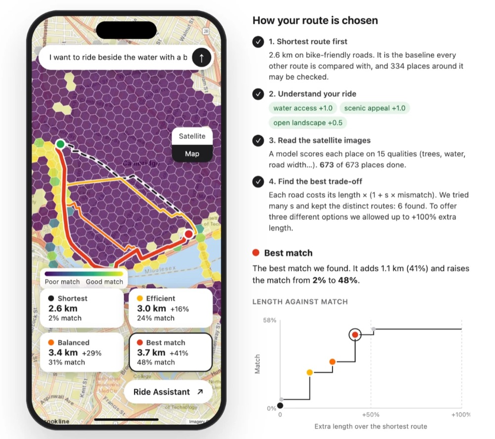
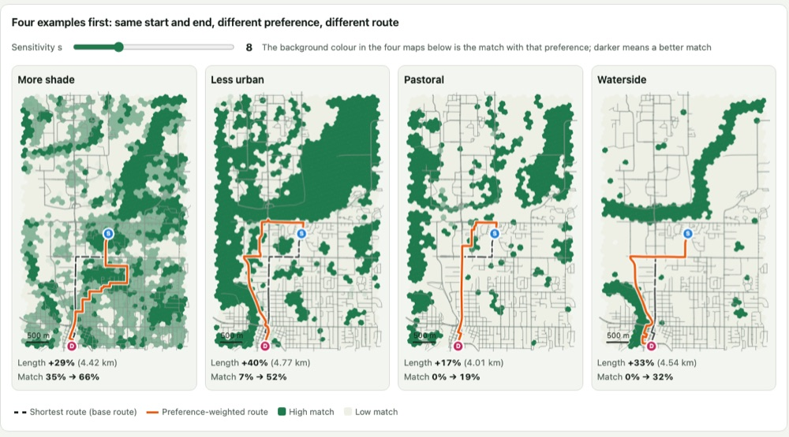
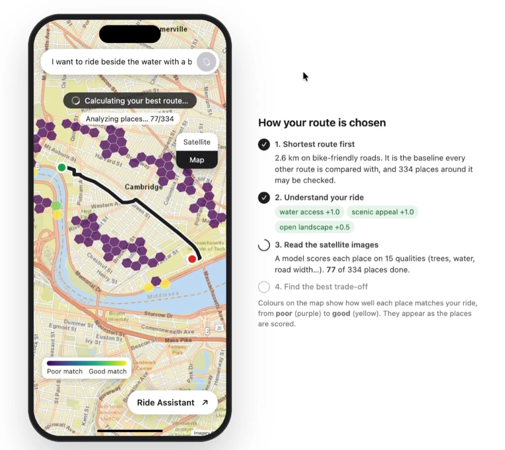

# How route planning works

Describe the ride you want, tap a start and an end, and get the **shortest route plus three options** that trade a little extra
distance for a route that fits the ride better. Full reference: [`src/api-service/ROUTING.md`](../src/api-service/ROUTING.md).



## The idea

1. **Read the scenery.** A model scores every small hexagonal cell (about 130 m) on 15 qualities between 0 and 1 from its aerial
   image: tree canopy, water access, road width, open views, …
2. **Read the ride.** Gemini turns the sentence into a weight per quality, from −1 (avoid) to +1 (want): "beside the water, nice
   view" becomes *water access +1, scenic appeal +1, open landscape +0.5*. Each cell then gets a **mismatch** from 0 (fits) to 1 (does not).
3. **Make poor roads feel longer.** Every road gets a cost, and the cheapest route is found with Dijkstra:

   ```
   cost = length × (1 + s × mismatch)
   ```

   `s` is how much extra distance the rider accepts to avoid a poor road. Two ways from A to B:

   | | Length | Mismatch | Cost, s = 0 | s = 1 | s = 4 |
   |---|---|---|---|---|---|
   | Direct, busy road | 1.0 km | 1.0 | **1.0** | 2.0 | 5.0 |
   | Detour, along a park | 1.3 km | 0.1 | 1.3 | **1.43** | **1.82** |

   Trying many values of `s` gives routes from the shortest to the most scenic.

   

4. **Offer three options**: *Efficient* (least extra distance), *Balanced*, *Best match* (fits best, most extra distance).
   They run along different streets (at most 70 % shared), a longer option always fits better, and the allowed extra length
   widens from +50 % to +100 % until three exist.



*The model and Gemini run at the same time; each batch of cells is coloured from poor (purple) to good (yellow) as it arrives.*

## Technical reference

```
Browser ──► Next.js (frontend) ──► API service ──┬─► Model Service (Cloud Run): 15 scores per cell
                                                 ├─► Gemini (Vertex AI): text → weights
                                                 └─► road graph + area baseline (files in the image)
```

| Endpoint | Purpose |
|---|---|
| `POST /route/plan` | Shortest route and the cells to score (instant, no text) |
| `POST /route/stream` | Options for a text, as progress events (newline-delimited JSON) |
| `POST /route` | The same, as one JSON response |

```bash
curl -s -X POST localhost:9000/route -H 'Content-Type: application/json' \
  -d '{"origin":{"lat":42.3467,"lon":-71.0972},"destination":{"lat":42.3588,"lon":-71.0707},"text":"a shady, quiet ride"}'
```

Code: `src/api-service/api/{route_search,road_graph,routing}.py`; data: `src/api-service/data/` (road graph from `src/routing-graph/`,
area baseline); UI: `src/frontend/src/`.

```bash
gcloud run services proxy greenpath-model-service --region us-central1 --port 8080   # private Model Service
cd src/api-service && GCP_PROJECT=<project-id> MODEL_SERVICE_URL=http://localhost:8080 uv run uvicorn api.service:app --port 9000
cd src/frontend && API_SERVICE_URL=http://localhost:9000 npm run dev                  # http://localhost:3000
cd src/api-service && uv run pytest && cd ../frontend && npm test                    # tests
```

- Planning takes 0.1–1.3 s; the Model Service dominates (a cold start takes about 40 s).
- Supported area: Boston, about 5.8 km × 5.6 km. The road graph is undirected and has no bike-lane or elevation data.
- *Match* is relative to the area, and for wishes few places satisfy (water, farmland) there may be no better route: the options are then marked "other streets".
